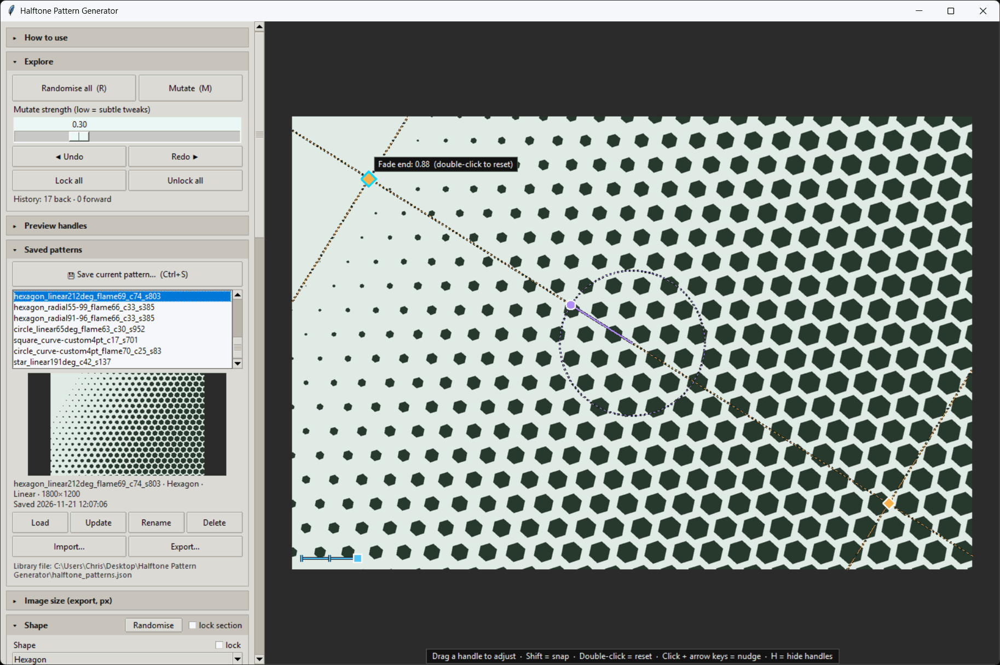
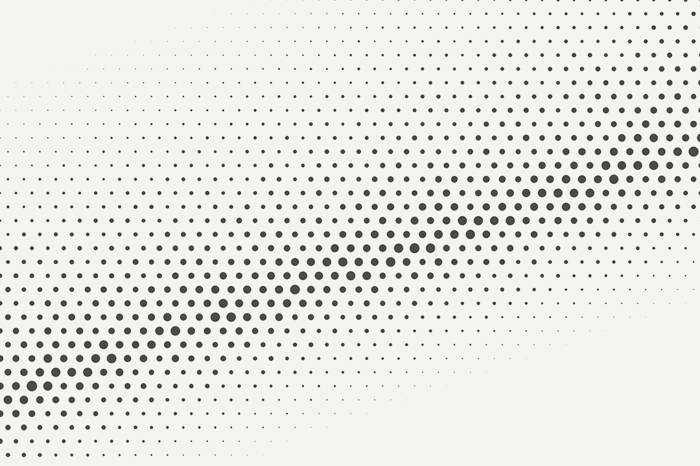
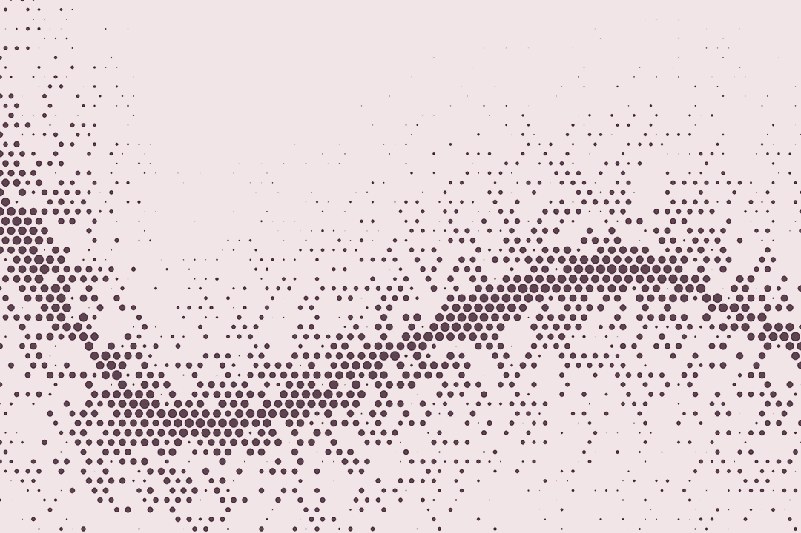
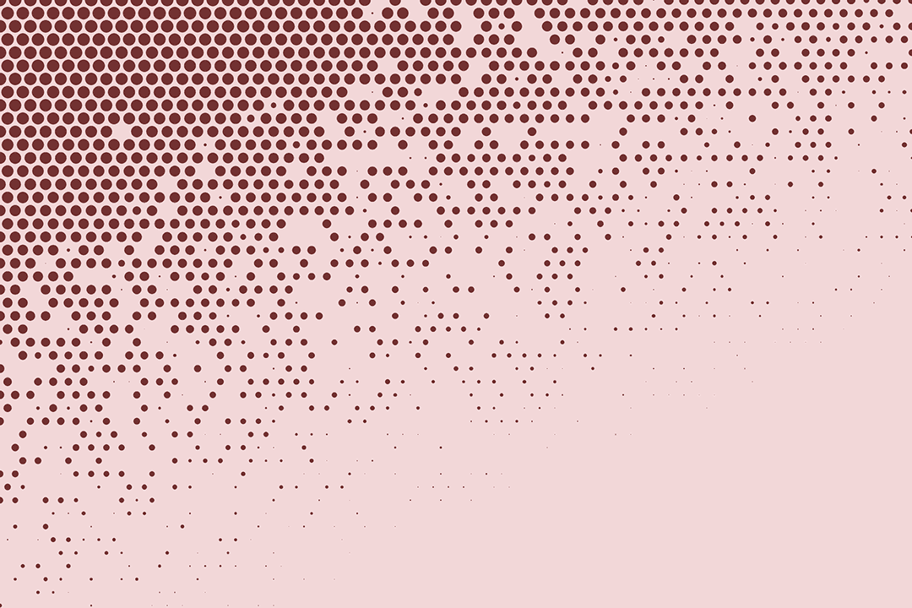
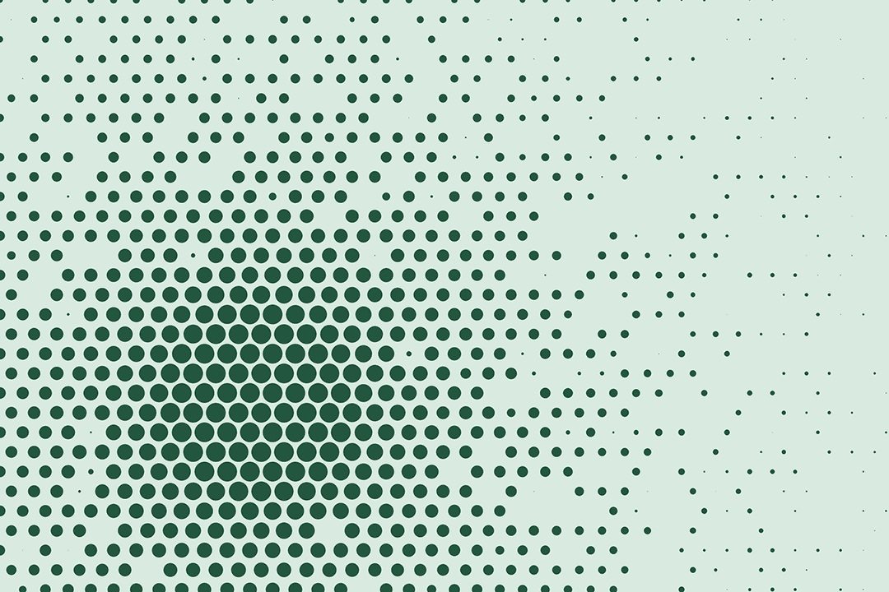
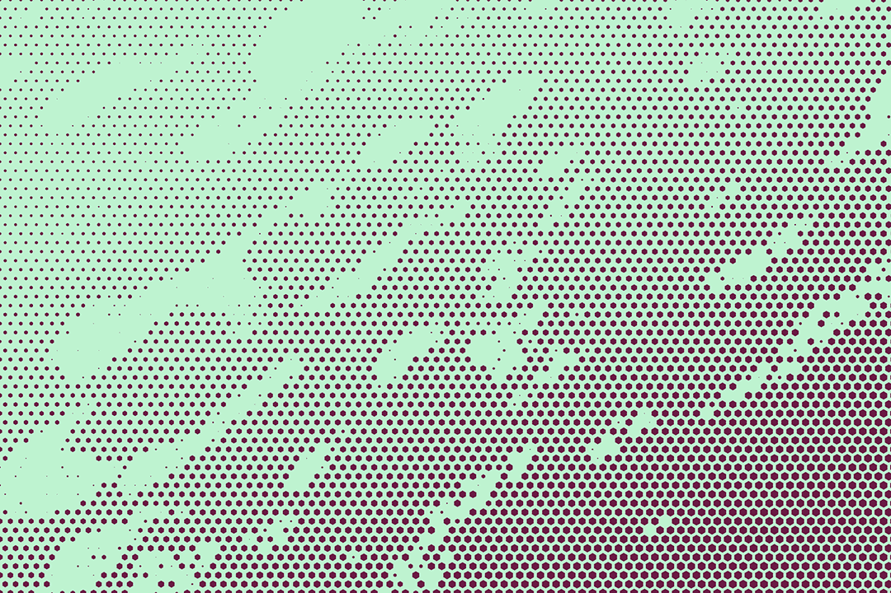
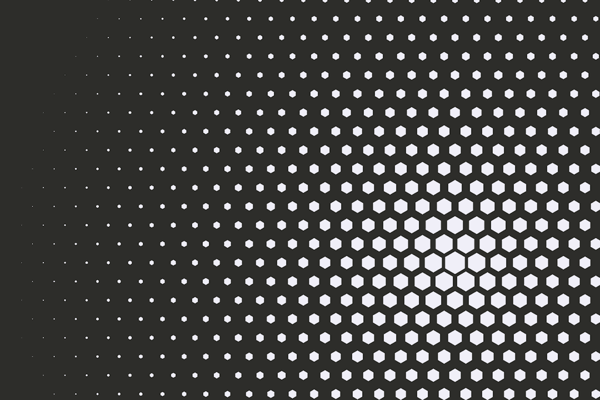
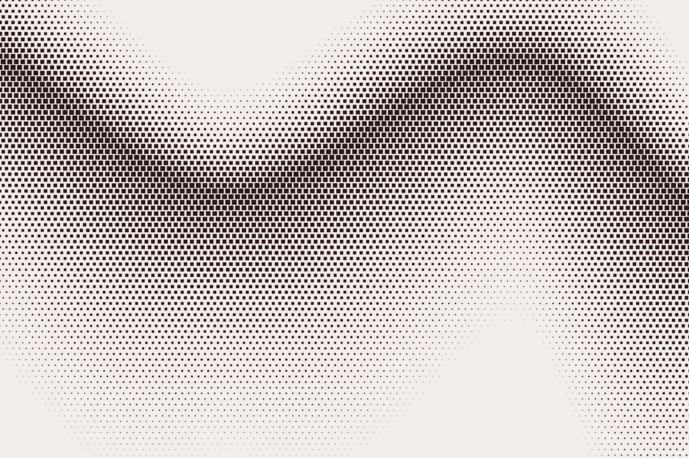
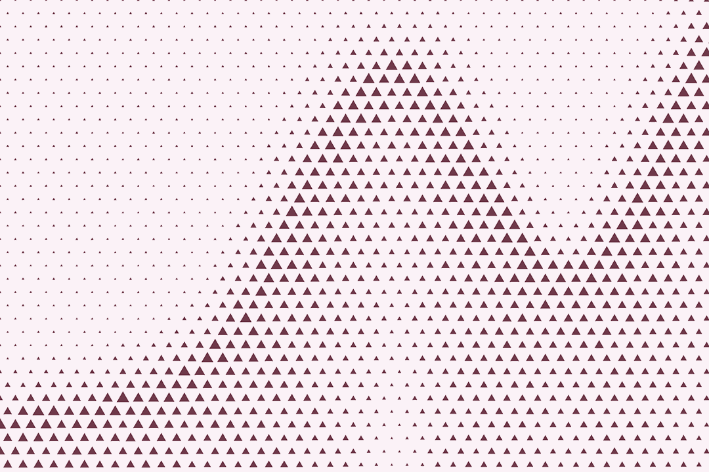

# Halftone Pattern Generator: Interactive Fading Shape-Grid Designer

Create halftone patterns of hexagons, circles, stars and more that fade smoothly across the image.  Live preview-base design with high-resolution PNG export.

Built in Python with a simple desktop UI.  Only one dependency: [Pillow](https://github.com/python-pillow/Pillow).

### Example screenshot 🖼️

### Key functions and features ⚡
 -  **Live preview** that updates instantly as you adjust settings
 -  **Seven shapes:** hexagon, circle, square, diamond, triangle, octagon and star, on an offset or square grid
 -  **Four fade modes:**
	 -  **Curve:** shapes follow a freely editable curve that you drag directly on the preview
	 -  **Linear:** a straight fade at any angle
	 -  **Radial:** a fade outwards from any point
	 -  **None:** a uniform grid
 -  **Flame effect** that breaks up the faded edge with organic, flame-like dropout
 -  **On-image handles** to drag the curve, fade points, radial centre, angles and cell size
 -  **Randomise and Mutate** functions to explore new designs, either across everything or one section at a time
 -  **Lock any setting** to keep what you like while randomising the rest
 -  **Undo and redo** for every change made
 -  **Saved pattern library** with thumbnails, plus import and export for sharing
 -  **Export PNGs at any resolution**, with smooth anti-aliased edges and optional transparent backgrounds
 -  **Custom colours** with automatic contrasting palettes

### Requirements 🔧
- **Python 3.8+** with Tkinter (included with most Python installs).
- **Pillow:** `pip install pillow`

### Quick start 🚀
Clone the repository:

    git clone https://github.com/cjastone/halftone-generator.git
    cd halftone-generator

Run the app:

    python halftone_generator.py

Press **R** a few times to explore random designs.  Lock the settings you like, then keep randomising or fine-tune by hand.

### Keyboard shortcuts ⌨️
| Key | Action |
|---|---|
| `R` | Randomise all unlocked settings |
| `M` | Mutate (small random tweaks) |
| `H` | Show or hide preview handles |
| `Ctrl+S` | Save the current pattern |
| `Ctrl+Z` / `Ctrl+Y` | Undo / redo |

### Development notes
Saved patterns are stored in `./halftone_patterns.json`.
Panel layout (folded sections) is stored in `./halftone_ui.json`.

Built with Claude Opus 5.5.

### Image gallery
Examples of the patterns generated using this tool.  Click a thumbnail to view the full-size image.
<table>
  <tr>
    <td width="25%"></td>
    <td width="25%"></td>
    <td width="25%"></td>
    <td width="25%"></td>
  </tr>
  <tr>
    <td width="25%"></td>
    <td width="25%"></td>
    <td width="25%"></td>
    <td width="25%"></td>
  </tr>
  <tr>
    <td width="25%"></td>
    <td width="25%"></td>
    <td width="25%"></td>
    <td width="25%"></td>
  </tr>
  <tr>
    <td width="25%"></td>
    <td width="25%"></td>
    <td width="25%"></td>
    <td width="25%"></td>
  </tr>
</table>